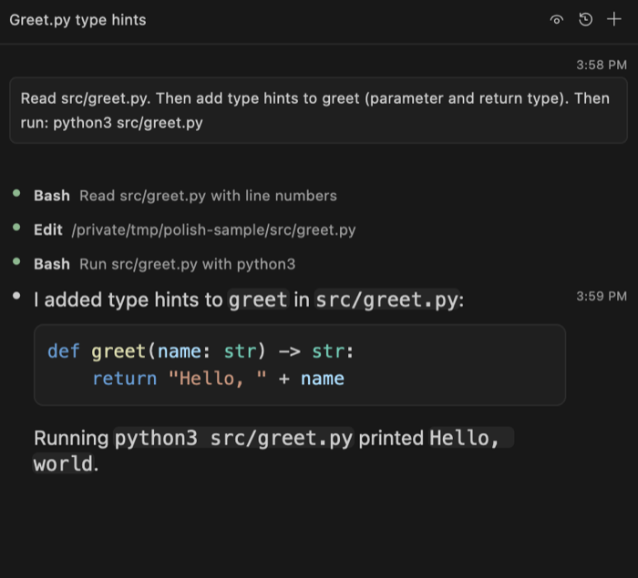
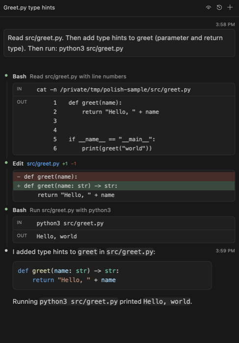
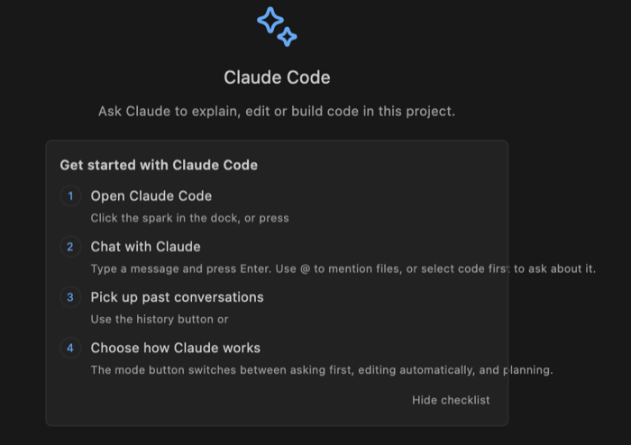
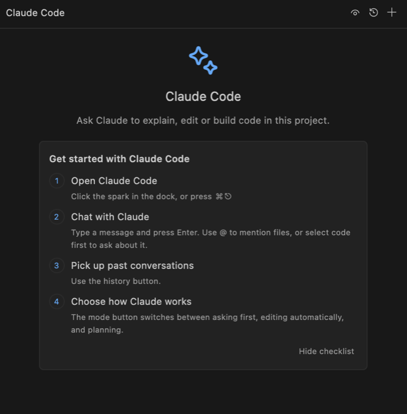

# Claude Code in Vireo: parity checklist

Vireo's Claude Code panel is a native GPUI implementation (crates `claude_code_ui` and
`claude_ide`) that aims at the same features as the official Claude Code extension for VS Code,
version **2.1.328**. The extension is proprietary. It was used only as a reference: features were
inventoried from its `package.json`, by watching it run, and from Anthropic's public
documentation. No code, styles, fonts, images or logos were taken from it.

This page is the checklist for that work. Each row gives the feature, how the extension behaves, and
Vireo's status:

- **Done**: works as described.
- **Partial**: the core works; the note says what is missing.
- **Todo**: not built yet.
- **N/A**: does not apply to Vireo; the note says why.

The column "Item" names the work item of the Foundation batch that owns the row (B-2 to B-8).

## Commands

The extension declares 31 commands. Vireo exposes them as `claude_code::*` actions.

| Extension command | Title | Behaviour | Vireo action | Item | Status |
| --- | --- | --- | --- | --- | --- |
| `claude-vscode.editor.open` | Open in New Tab | Opens a new conversation in an editor tab. | `claude_code::OpenInNewTab` | B-4 | Done |
| `claude-vscode.editor.openLast` | Open | Editor title-bar button. Opens Claude where it was last opened (`preferredLocation`). | `claude_code::Open` | B-4 | Done |
| `claude-vscode.primaryEditor.open` | Open in Primary Editor | Opens Claude in the main editor group. | `claude_code::OpenInPrimaryEditor` | B-4 | Done |
| `claude-vscode.window.open` | Open in New Window | Opens Claude alone in a new window. | `claude_code::OpenInNewWindow` | B-4 | Done |
| `claude-vscode.sidebar.open` | Open in Side Bar | Opens Claude in the secondary side bar. | `claude_code::OpenInSideBar` (right dock) | B-4 | Done |
| `claude-vscode.newConversation` | New Conversation | Starts a new conversation in the focused Claude view. | `claude_code::NewConversation` | B-4 | Done |
| `claude-vscode.reopenClosedSession` | Reopen Closed Session | Reopens the most recently closed session tab. | `claude_code::ReopenClosedSession` | B-6 | Done: reopens the last closed Claude tab when that was the last thing closed, otherwise falls through to reopening the last closed item |
| `claude-vscode.update` | Update extension | Updates the extension. | — | — | N/A: Vireo ships the panel in the app; it updates with Vireo. |
| `claude-vscode.focus` | Focus input | Moves focus to the message box. | `claude_code::FocusInput` | B-4 | Done |
| `claude-vscode.focusLastMessage` | Focus last message | Moves focus to the last message, for screen readers. | `claude_code::FocusLastMessage` | B-4 | Done |
| `claude-vscode.blur` | Blur input | Gives focus back to the editor. | `claude_code::BlurInput` | B-4 | Done |
| `claude-vscode.logout` | Logout | Runs the CLI's logout. | `claude_code::Logout` | B-8 | Done: runs `claude auth logout` and reports in a toast |
| `claude-vscode.terminal.open` | Open in Terminal | Runs `claude` in an integrated terminal. | `claude_code::OpenInTerminal` | B-8 | Done: a new terminal running `claude`, with `CLAUDE_CODE_SSE_PORT` so it connects to Vireo |
| `claude-vscode.acceptProposedDiff` | Accept Proposed Changes | Accepts the whole proposed diff. | `claude_code::AcceptProposedDiff` | B-5 | Done |
| `claude-vscode.rejectProposedDiff` | Reject Proposed Changes | Rejects the whole proposed diff. | `claude_code::RejectProposedDiff` | B-5 | Done |
| `claude-vscode.acceptProposedHunk` | Accept Change at Cursor | Accepts the hunk under the cursor. | `claude_code::AcceptProposedHunk` | B-5 | Done |
| `claude-vscode.rejectProposedHunk` | Reject Change at Cursor | Rejects the hunk under the cursor. | `claude_code::RejectProposedHunk` | B-5 | Done |
| `claude-vscode.acceptProposedHunkFromBar` | Accept this change | Button on the per-hunk comment bar. | Hunk button calling `AcceptProposedHunk` | B-5 | Done |
| `claude-vscode.rejectProposedHunkFromBar` | Reject this change | Button on the per-hunk comment bar. | Hunk button calling `RejectProposedHunk` | B-5 | Done |
| `claude-vscode.insertAtMention` | Insert @-Mention Reference | Inserts `@file#start-end` for the editor selection into the message box. | `claude_code::InsertAtMention` | B-4 | Done |
| `claude-vscode.addToChat` | Add to Chat | Explorer context menu: adds a file or folder as an @-mention. | `claude_code::AddToChat` | B-8 | Done: adds the active file; the project panel entry sends `claude_code::AddPathsToChat` with the selected entries |
| `claude-vscode.installPlugin` | Install Plugin | Installs a Claude Code plugin by name. | `claude_code::InstallPlugin` | B-8 | Done: opens the CLI's `/plugin` manager in a terminal |
| `claude-code.acceptProposedDiff` | Accept Proposed Changes | Terminal-mode (`/ide`) variant: accepts a diff opened by `openDiff`. | `claude_code::AcceptProposedDiff` (same action) | B-5 | Done |
| `claude-code.rejectProposedDiff` | Reject Proposed Changes | Terminal-mode variant. | `claude_code::RejectProposedDiff` (same action) | B-5 | Done |
| `claude-code.insertAtMentioned` | Insert At-Mentioned | Terminal mode: sends an `at_mentioned` notification to the connected CLI. | `claude_code::InsertAtMentioned` | B-3, B-4 | Done |
| `claude-vscode.showLogs` | Show Logs | Opens the extension's log channel. | `claude_code::ShowLogs` | B-8 | Done: a read-only buffer with Vireo's notes and the CLI's debug output (last 5000 lines) |
| `claude-vscode.toggleFocusView` | Toggle Focus view | Hides tool calls and activity, showing only prompts and replies. | `claude_code::ToggleFocusView` | B-4 | Done |
| `claude-vscode.openWalkthrough` | Open Walkthrough | Opens the "Get started" walkthrough. | `claude_code::OpenWalkthrough` | B-8 | Done: shows the checklist again (clears `hide_onboarding`) in an empty conversation |
| `claude-vscode.markSessionUnread` | Mark Session as Unread | Marks the session tab unread. | `claude_code::MarkSessionUnread` | B-6 | Done |
| `claude-vscode.renameSessionTab` | Rename Session Tab | Renames the session. | `claude_code::RenameSession` | B-6 | Done |
| `claude-vscode.addSessionTabToGroup` | Add Session Tab to Group | Puts the session in a named group of the sessions list. | `claude_code::AddSessionToGroup` | B-6 | Done |

The extension also binds `claude-vscode.terminal.open.keyboard`, an internal variant of "Open in
Terminal" used only by the keybinding, and `claude-vscode.toggleDictation`, the voice dictation key
(`cmd+d`, not in the command palette). Vireo maps them to `claude_code::OpenInTerminal` and
`claude_code::ToggleDictation`.

## Keybindings

| Keys (macOS / Linux, Windows) | Command | When | Vireo | Item | Status |
| --- | --- | --- | --- | --- | --- |
| `alt-k` / `alt-k` | Insert @-mention | Editor focused | `claude_code::InsertAtMention` in `Editor` context | B-7 | Done |
| `cmd-escape` / `ctrl-escape` | Focus input | Editor focused, not terminal mode | `claude_code::FocusInput` in `Editor` context | B-7 | Done |
| `cmd-escape` / `ctrl-escape` | Blur input | Claude input focused | `claude_code::BlurInput` in `ClaudeCode` context | B-7 | Done |
| `cmd-escape` / `ctrl-escape` | Open in Terminal | `useTerminal` is on | Same key; `FocusInput` opens the terminal when `use_terminal` is on | B-7 | Done |
| `cmd-shift-escape` / `ctrl-shift-escape` | Open in New Tab | Not terminal mode | `claude_code::OpenInNewTab` | B-7 | Done |
| `cmd-alt-k` / `ctrl-alt-k` | Insert At-Mentioned (terminal mode) | Editor focused | `claude_code::InsertAtMentioned` | B-7 | Done |
| `cmd-n` / `ctrl-n` | New Conversation | `enableNewConversationShortcut` and Claude focused | `claude_code::NewConversation` in `ClaudeCode && new_conversation_shortcut`; with the setting off the key stays New File | B-7 | Done |
| `ctrl-alt-f` | Toggle Focus view | Claude focused | `claude_code::ToggleFocusView` in `ClaudeCode` context | B-7 | Done |
| `cmd-shift-t` / `ctrl-shift-t` | Reopen Closed Session | `enableReopenClosedSessionShortcut` and a Claude tab was closed last | `claude_code::ReopenClosedSession` in `Workspace`, replacing `pane::ReopenClosedItem`, which it falls back to | B-7 | Done |
| `cmd-d` / `ctrl-d` | Toggle dictation | Claude input focused | `claude_code::ToggleDictation` in `ClaudeCode` and the Claude input | B-7, B-8 | Partial: the key works; dictation itself is not built (see Voice input) |
| `enter` / `cmd-enter` | Send (depends on `useCtrlEnterToSend`) | Claude input focused | Input key handling | B-4 | Done |
| `escape` | Stop the running turn | Claude focused while running | `claude_code::Interrupt` | B-4 | Done |

## Settings

The extension's settings live under `claudeCode.*`; Vireo's live under `claude_code` in
`settings.json`, in snake case, with the same defaults.

| Extension setting | Type, default | Behaviour | Vireo key | Item | Status |
| --- | --- | --- | --- | --- | --- |
| `environmentVariables` | array of `{name, value}`, `[]` | Extra environment for the `claude` process. | `environment_variables` | B-2 | Done |
| `useTerminal` | bool, `false` | Run Claude in the terminal instead of the native UI. | `use_terminal` | B-8 | Done: Focus input and Open run `claude` in a terminal; Add to Chat and Insert @-mention send `at_mentioned` to it |
| `allowDangerouslySkipPermissions` | bool, unset (false) | Adds "Bypass permissions" to the mode menu. | `allow_dangerously_skip_permissions` | B-4 | Done |
| `claudeProcessWrapper` | string, unset | Executable used to launch Claude; the `claude` path is passed to it. | `claude_process_wrapper` | B-2 | Done |
| `respectGitIgnore` | bool, `true` | File search for @-mentions respects `.gitignore`. | `respect_git_ignore` | B-4 | Done |
| `initialPermissionMode` | enum `default`, `manual`, `acceptEdits`, `plan`, `bypassPermissions`; unset | Mode of new conversations; `manual` is an alias of `default`. | `initial_permission_mode` | B-2 | Done |
| `disableLoginPrompt` | bool, `false` | Never show the login screen. | `disable_login_prompt` | B-8 | Done: hides the "not signed in" prompt |
| `autosave` | bool, `true` | Save dirty buffers before Claude reads or writes them. | `autosave` | B-2 | Done |
| `focusView` | bool, `false` | Start in focus view. | `focus_view` | B-4 | Done |
| `useCtrlEnterToSend` | bool, `false` | Cmd/Ctrl+Enter sends, Enter inserts a newline. | `use_ctrl_enter_to_send` | B-4 | Done |
| `preferredLocation` | `sidebar` or `panel`, `panel` | Where Claude opens; updated when the user opens it elsewhere. | `preferred_location` | B-4 | Partial: `Open` and the focus key follow it (`panel` = an editor tab, `sidebar` = the right dock); it is not yet updated when Claude is opened elsewhere |
| `lockEditorGroups` | bool, `true` | Lock the editor group of a Claude tab. | `lock_editor_groups` | B-4 | Todo: accepted in settings but not applied; Vireo has no locked panes yet |
| `enableNewConversationShortcut` | bool, `false` | Enables Cmd/Ctrl+N for a new conversation. | `enable_new_conversation_shortcut` | B-7 | Done |
| `enableReopenClosedSessionShortcut` | bool, `true` | Enables Cmd/Ctrl+Shift+T for the last closed session. | `enable_reopen_closed_session_shortcut` | B-7 | Done |
| `hideOnboarding` | bool, `false` | Hide the onboarding checklist. | `hide_onboarding` | B-8 | Done |
| `attachOpenFile` | bool, `true` | Attach the open file to messages and show it as a chip. | `attach_open_file` | B-4 | Done |
| `attachSelection` | bool, `true` | Attach the editor selection to messages and show it as a chip. | `attach_selection` | B-4 | Done |
| `continueAfterReload` | bool, `true` | After a reload, a restored session continues the interrupted step. | `continue_after_reload` | B-6 | Done: the panel's session; a session that was in plan mode is restored without continuing |
| `scrollToBottomOnSend` | bool, `true` | Scroll to the bottom on send. | `scroll_to_bottom_on_send` | B-4 | Done |
| `showMessageTimestamps` | bool, `true` | Show message times and a date line when the day changes. | `show_message_timestamps` | B-4 | Done |
| `promptSuggestions` | bool, `true` | Show a suggested next prompt in the empty message box. | `prompt_suggestions` | B-4 | Done |
| `spinnerVerbs` | `{mode: append or replace, verbs: []}` | Verbs shown while Claude works. | `spinner_verbs` | B-4 | Done |
| `archiveInactiveSessions` | number (0, 1, 2, 7, 14), `14` | Archive sessions idle this many days; 0 disables. | `archive_inactive_sessions` | B-6 | Done: applied when the sessions list opens; open sessions are never archived |
| `usePythonEnvironment` | bool, `true` | Activate the workspace's Python environment for Claude. | `use_python_environment` | B-2 | Done |

## Menus and places

| Place | Extension | Vireo | Item | Status |
| --- | --- | --- | --- | --- |
| Editor title bar | Spark button "Open"; Accept / Reject buttons while a proposed diff is shown. | Claude button in the tab bar; Accept / Reject buttons in the diff view's toolbar. | B-4, B-5 | Done: Accept / Reject in the proposed diff's header |
| Editor context menu | Accept / Reject change at cursor, in the proposed diff. | Same entries in the diff editor's context menu. | B-5 | Done |
| Comment bar on each hunk | "Accept this change" / "Reject this change". | Per-hunk accept / reject buttons. | B-5 | Done |
| Explorer context menu | "Claude Code: Add to Chat" on files and folders, not on roots. | Project panel context menu entry. | B-8 | Done: "Claude Code: Add to Chat" on local files and folders other than roots, for every selected entry |
| Session tab context menu | Mark Session as Unread, Rename Session Tab, Add Session Tab to Group. | Tab context menu and sessions list menu. | B-6 | Done: the three entries in the Claude tab's context menu; they act on the active Claude tab |
| Activity bar / secondary side bar | Claude Code view container; a separate sessions-list view when enabled. | Right dock panel with its own sessions list. | B-4, B-6 | Done |
| Status bar | "✻ Claude Code" item that opens Claude. | Dock button with Claude's icon. | B-4 | Done |
| Walkthrough "Get started with Claude Code" | Steps: welcome, open Claude Code, chat with Claude, past conversations. | Onboarding checklist in the empty panel. | B-8 | Done |
| URI handler | `vscode://anthropic.claude-code/open?prompt=…&session=…` pre-fills a prompt or resumes a session. | `zed://claude-code/open?…` | B-8 | Done: `prompt` fills the input without sending; `session` resumes that session in a new tab |

## Chat view

Observed in the running extension, version 2.1.328.

| Feature | Extension behaviour | Item | Status |
| --- | --- | --- | --- |
| Header | Session title on the left. On the right: bookmarks, session history (clock icon), new conversation (+). | B-4 | Partial: title, focus view, past conversations and new conversation; no bookmarks list |
| Message list | User messages in a bordered box. Assistant output hangs off a vertical timeline with a dot per step: text, thinking, tool calls. | B-4 | Done |
| Markdown | Assistant text renders as Markdown: headings, lists, links, inline code, code blocks. | B-4 | Done |
| Thinking | Collapsed row "Thought for Ns"; expands to the thinking text. "Thinking…" while it streams. | B-4 | Done |
| Tool-call blocks | A row naming the tool and its description, e.g. "Bash  Check the build result". Expanded, an IN block shows the input and an OUT block the result. The dot is green on success, red on error, animated while running. | B-4, Polish A-2a | Done: calls start open, as in the extension; output shows 12 lines with "Show more" (up to 40); clicking the row closes it |
| Edit / Write blocks | File name and a small inline diff of the change. | B-4, Polish A-2a | Done: the path relative to the project, "+added −removed", and the changed lines on red and green backgrounds with shared lines as context; not syntax-highlighted. The full diff opens in the review view (B-5) |
| Permission prompts | Inline card for a tool that needs approval: "Yes", "Yes, and don't ask again" (or "Yes, allow all edits this session"), and "No" with a "Tell Claude what to do instead" field. Up/down and number keys pick an option. | B-4 | Partial: Yes, Yes and don't ask again (sends the CLI's suggestions), No with a message; number keys are not bound |
| Plan approval | In plan mode, the plan is shown for approval, with an option to keep planning. | B-4 | Partial: shown as the permission card of the plan tool |
| AskUserQuestion | Questions from Claude render as a picker with options and free text. | B-4 | Todo: shown as a generic permission card |
| Mode switcher | Button at the bottom right of the input box. Modes: Auto, Manual (`default`), Edit automatically (`acceptEdits`), Plan (`plan`), and Bypass permissions (`bypassPermissions`) only when `allowDangerouslySkipPermissions` is on. Shift+Tab cycles. | B-4 | Done: Auto is always offered, so a conversation that started in another mode can switch to it; `initial_permission_mode` accepts `"auto"` |
| Model picker | Pill "Opus 5.5 High": model and effort level. Opens a menu of models and effort levels. | B-4 | Partial: models from the CLI; no effort levels |
| Thinking toggle | In the model / command menu: thinking on or off. | B-4 | Done |
| Slash commands | "/" button and typing "/" open a menu of commands from the CLI's `slash_commands` list and local actions: clear conversation, new conversation, focus view, account and usage, switch model, and so on. | B-4 | Done: typing "/" at the start of the message, or the / button, opens a list above the message box that filters as you type and scrolls; Up and Down move, Enter or Tab inserts a command (or runs a local action), Escape closes it |
| @-mentions | Typing "@" opens a fuzzy file and folder picker ("Mention file from this project…"); folders end in "/". `@terminal:name` references a terminal. | B-4, Polish A-1 | Partial: typing "@" at the start of the message or after a space opens a list above the message box with the project's files and folders (folders end in "/"), fuzzy-matched on what follows the "@", at most 50, honouring `respect_git_ignore`; Up and Down move, Enter or Tab inserts `@path `, Escape closes it. An "@" inside a word (an email address) does not open it. "Mention file from this project…" still opens the picker. `@terminal:` is not offered |
| Attach button (+) | Menu: "Upload from computer" / "Attach file…", "Add context", "Mention file from this project…". | B-4 | Done |
| Image paste | Pasting or dropping an image adds an image chip; it is sent as a base64 image block. | B-4 | Done |
| Attachment chips | Chips above the text for the open file, the selection (`file#5-10`), images and mentions; each removable. | B-4 | Done |
| Prompt suggestions | After a reply, the empty input shows a suggested next prompt in italics; Tab accepts it. | B-4 | Done |
| Timestamps | Time at the right of each message; a date line when the day changes. | B-4 | Done |
| Status banner | Banner above the input, e.g. "Browser connected", dismissible. | B-4 | Done |
| Usage display | Clock icon with time until the session limit resets ("59m"); "Account & usage" shows session and weekly limits. Context usage per conversation. | B-4 | Partial: time to the rate-limit reset, context tokens and cost in a tooltip; no Account & usage view |
| Spinner | While working: a verb from the spinner list, or "Running <tool>…". | B-4 | Done |
| Queued messages | A message sent while Claude works is queued ("Message queued."). | B-4 | Done |
| Stop | Stop button and Escape interrupt the turn. | B-4 | Done |
| Focus view | Hides tool calls and thinking; a live indicator names the running tool. | B-4 | Done |
| Rewind and fork | Hover a user message: "Fork conversation from here", "Rewind code to here", "Fork conversation and rewind code". | B-6 | Done: hover buttons on each prompt; a fork opens in a new tab with `--resume --fork-session --resume-session-at` and the prompt back in the input; rewinding uses the `rewind_files` control request |
| Copy and bookmark | "Copy response" and "Bookmark response" under each reply; a bookmarks list in the header. | B-4 | Todo |
| Sessions list | History button: search ("Search sessions…"), groups, archived sessions, rename, archive, mark unread. | B-6 | Done: `claude_code::ShowSessions` lists this folder's transcripts by last activity, with search, groups, an `archived:` filter and an archive button; rename, group and unread go through the commands above |
| Session tabs | Several sessions open as editor tabs; unread dot; a closed tab can be reopened. | B-6 | Done |
| Onboarding | Empty state: "Welcome to Claude Code", a short checklist, and the login choices (claude.ai account, Anthropic Console, third-party providers). | B-8 | Partial: the welcome and the checklist; login runs the CLI's own `claude auth login`, which offers the account choices |
| Login | Uses the CLI's login. "Sign in again", "Log in with a different account". | B-8 | Done: when the CLI reports it is not signed in, the input shows "Claude Code is not signed in" with Log in (`claude auth login` in a terminal); Logout, then Log in, switches accounts |
| Voice input | Mic button in the input; dictation through the native audio-capture module, signed in to claude.ai. | B-8 | Partial: `claude_code::ToggleDictation` and its key exist but only say dictation is not available yet; no audio capture or speech-to-text yet |

**Where sessions live (B-6).** The conversations themselves are the CLI's transcripts,
`~/.claude/projects/<folder>/<session>.jsonl` (`CLAUDE_CONFIG_DIR` is honoured), so sessions
started in a terminal show up too. What only Vireo knows (custom titles, groups, unread, archived,
and which session the panel had open, for `continue_after_reload`) is kept in
`<Vireo data dir>/claude_code/sessions.json`. Resuming a session replays its transcript into the
view and starts `claude --resume=<id>`.

## Design

Batch Polish (A-2) compared the panel with the extension (2.1.329) by screenshots: the same
conversation, one transcript resumed in both, side by side, with the empty panel and the message
box. Only the look was compared. Vireo uses its theme's colors, its UI and buffer fonts, and its own
icons.

What changed:

- **Tool calls start open** with their IN and OUT blocks, as in the extension, instead of one-line
  rows. Long output shows 12 lines and a "Show more" button.
- **Edit and Write show an inline diff**, red and green on the theme's deleted and created colors,
  under a header with the relative path and "+added −removed".
- **One text size.** Claude's replies use the panel's 14 px text (scaled by `ui_font_size`) instead
  of the larger agent font, code 13 px. The user's message uses the same size.
- **A rail joins the timeline's dots**, from each step to the next, stopping at a user message.
- **The empty state's checklist** keeps its text inside the card and shows each step's key from the
  keymap, or none when the action has no key.
- **The model is a pill** in the message box.

Before and after, the same conversation:





The empty state, before and after:





Still different from the extension, for a later batch:

- The permission card was not compared. A live permission prompt needs typing into both apps.
- The extension's empty state is sparser: a small logo, one line, the message box at the bottom.
  Vireo keeps its checklist until `hide_onboarding`.
- The model pill has no effort level, and the message box has no microphone (see Voice input).
- The header has no bookmarks button.
- Diff lines are not syntax-highlighted.

## The `claude` process

What the extension does when it runs Claude, observed with `ps` on the processes it starts:

```sh
claude --output-format stream-json --verbose --input-format stream-json \
  --max-thinking-tokens=31999 --permission-prompt-tool=stdio \
  [--resume=<session id>] --setting-sources=user,project,local \
  --permission-mode=<mode> --include-partial-messages \
  --debug --debug-to-stderr --enable-auth-status --no-chrome --replay-user-messages
```

Environment it adds: `CLAUDE_CODE_ENTRYPOINT=claude-vscode`, `CLAUDE_AGENT_SDK_VERSION`,
`CLAUDE_CODE_SDK_READS_SESSION_STATE=1`, `CLAUDE_CODE_ENABLE_SDK_FILE_CHECKPOINTING=true`,
`MCP_CONNECTION_NONBLOCKING=true`, `CLAUDE_CODE_EMIT_USER_PROMPT_SUBMIT_HOOK_EVENTS=1` and a few
startup-reporting flags. The process it starts has no `CLAUDE_CODE_SSE_PORT`: the extension serves
its IDE tools to its own process through the control protocol, not through the WebSocket server.

The protocol is NDJSON on stdin and stdout, as in Anthropic's open-source Agent SDK:

- stdin, a prompt: `{"type":"user","session_id":"","message":{"role":"user","content":[…]},"parent_tool_use_id":null}`.
- stdin, a request to the CLI: `{"type":"control_request","request_id":"…","request":{"subtype":"initialize" | "interrupt" | "set_permission_mode" | "set_model" | "rewind_files" | …}}`.
- stdout, a request from the CLI: `can_use_tool` (`tool_name`, `input`, `permission_suggestions`, `tool_use_id`, `blocked_path`, `decision_reason`). The answer is a `control_response` with `{"behavior":"allow","updatedInput":…,"updatedPermissions":[…]}` or `{"behavior":"deny","message":"…","interrupt":false}`.
- stdout messages: `system` (`init` with session id, model, tools, slash commands; `session_state_changed`), `assistant`, `user` (tool results), `stream_event` (partial deltas), `result` (cost, usage, turns), `rate_limit_event`, `control_cancel_request`.

| Behaviour | Vireo | Item | Status |
| --- | --- | --- | --- |
| Find `claude`: the user's install on PATH, `~/.claude/local/claude`, or `claude_process_wrapper` | `claude_code_ui::process` | B-2 | Done |
| Bundle the binary | Not bundled: Vireo uses the user's installed CLI. | — | N/A by decision |
| Streaming, partial messages | `stream_event` deltas update the last message | B-2 | Done |
| Interrupt | `interrupt` control request | B-2 | Done |
| Permission requests | `can_use_tool` answered from the UI | B-2 | Done |
| Resume | `--resume=<id>` | B-2 | Done |
| Environment variables | `environment_variables` setting | B-2 | Done |
| Python environment | Prepends the bin folder of the workspace's `.venv`, `venv`, `env` or `.env` (one with `pyvenv.cfg`) to `PATH` and sets `VIRTUAL_ENV` | B-2 | Done |
| Autosave | A `PreToolUse` hook registered at `initialize` for Read, Edit, MultiEdit, Write and NotebookEdit; Vireo saves the file's dirty buffer before answering | B-2 | Done |

## IDE integration (`/ide`)

A `claude` started in a terminal finds the IDE through a lock file and connects over a WebSocket.
Observed against the extension's own server (2.1.328) and checked against the public protocol
notes of the open-source `claudecode.nvim` project.

**Lock file.** `~/.claude/ide/<port>.lock`, mode 0600, one per window:

```json
{"pid": 1090, "workspaceFolders": ["/path/to/project"], "ideName": "Visual Studio Code",
 "transport": "ws", "runningInWindows": false, "authToken": "<random token>"}
```

**Transport.** WebSocket on `127.0.0.1:<port>`. The client must send the header
`x-claude-code-ide-authorization: <authToken>`; any other connection is refused. Messages are
JSON-RPC 2.0 MCP (`initialize`, `notifications/initialized`, `tools/list`, `tools/call`). The
server answers `initialize` with protocol version `2025-06-18`, capability `tools.listChanged`, and
its name and version.

**Environment.** In the IDE's own terminals: `CLAUDE_CODE_SSE_PORT=<port>` and
`ENABLE_IDE_INTEGRATION=true`, so `claude` connects without `/ide`.

**Tools** (exactly these five in 2.1.328; results are `{"content":[{"type":"text","text":…}]}`):

| Tool | Input | Result | Vireo | Status |
| --- | --- | --- | --- | --- |
| `openDiff` | `old_file_path`, `new_file_path`, `new_file_contents`, `tab_name` (all required) | Blocks until the user decides. `FILE_SAVED` followed by the final contents, or `DIFF_REJECTED` followed by the tab name. | Opens the proposed-diff view and answers when the person accepts, rejects or reviews every hunk; closing the tab rejects | Done |
| `getDiagnostics` | `uri` (optional `file://` URI) | Pretty-printed JSON array, one entry per file: `[{"uri": "file:///…", "diagnostics": [{"message", "severity", "range": {"start": {"line", "character"}, "end": …}, "source", "code"}]}]`. The outer shape was observed; the item fields follow the public notes and VS Code's diagnostic type (0-based lines; severity `Error`, `Warning`, `Information` or `Hint`). | Diagnostics of the project's language servers, for one file or all files with diagnostics | Done |
| `close_tab` | `tab_name` | `TAB_CLOSED` | Closes the proposed diff with that name | Done |
| `closeAllDiffTabs` | none | `CLOSED_<n>_DIFF_TABS` | Closes every proposed diff | Done |
| `executeCode` | `code` | Text and image items from the kernel | Runs through a registered code executor; none is registered yet, so it answers that no Jupyter kernel is available | Partial |

Earlier versions also served `openFile`, `getCurrentSelection`, `getLatestSelection`,
`getOpenEditors`, `getWorkspaceFolders`, `checkDocumentDirty` and `saveDocument`. Vireo serves
them too, for older CLIs (done).

**Handshake details found by observing the CLI (2.1.329).** The CLI connects to `/` with
`sec-websocket-protocol: mcp`, `user-agent: claude-code/<version> (cli)` and the auth header. A
server that does not select the `mcp` subprotocol is dropped, and the CLI shows the IDE as
"disconnected".

**Panel sessions.** Like the extension, the panel does not give its own `claude` the WebSocket
port, which would make the CLI open a second diff next to the permission prompt. It declares an
in-process MCP server named `vireo` with `--mcp-config` and answers its `mcp_message` requests
itself, serving `getDiagnostics` and `executeCode` as `mcp__vireo__*` tools (done).

**Proposed diffs (B-5).** An Edit, MultiEdit or Write that the panel's `claude` asks permission
for opens a "<file> (proposed)" tab: the proposal as an editable buffer diffed against the file on
disk. Accept or Reject in its header answer for the whole file; each hunk has "Accept this change"
and "Reject this change"; the context menu has the cursor and whole-file variants. Once every hunk
is reviewed the tab closes and answers by itself. If the person edited the proposal, the tool is
allowed with its input rewritten to produce the edited text. Answering on the permission card
closes the tab, and closing the tab rejects. `openDiff` from a terminal `claude` uses the same
view.

**Terminals.** Each window's terminals get `CLAUDE_CODE_SSE_PORT` and `ENABLE_IDE_INTEGRATION`
through a per-project extra terminal environment in the `project` crate (done).

**Notifications.**

| Direction | Method | Params | Status |
| --- | --- | --- | --- |
| IDE → CLI | `selection_changed` | `text`, `filePath`, `fileUrl`, `selection: {start: {line, character}, end: {line, character}, isEmpty}`; 0-based; sent 50 ms after the selection of a file editor changes | Done |
| IDE → CLI | `at_mentioned` | `filePath`, `lineStart`, `lineEnd` (0-based) | Done |
| CLI → IDE | `ide_connected` | `pid` | Done |

| Behaviour | Item | Status |
| --- | --- | --- |
| Vireo is listed by `/ide` and `claude` in its terminal connects (the server selects the `mcp` WebSocket subprotocol the CLI asks for) | B-3 | Done |
| Selections and diagnostics reach Claude | B-3 | Done |
